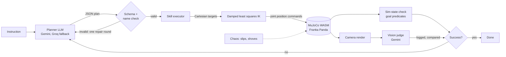

# Sim-to-Hand

Type a tabletop task in plain English. An LLM plans it, MuJoCo runs it in your browser, two independent checks verify it, and the agent replans when it fails.

**Live demo:** https://sim-to-hand.vercel.app


## What it does

- A Franka Panda arm, a table, colored cubes and three colored zones, simulated with the official MuJoCo WebAssembly build.
- Presets: stack two cubes, sort by color, build a 3-cube tower. Or type any instruction.
- The LLM only picks from five skills: `move_to`, `grasp`, `lift`, `place`, `release`. It never outputs joint angles or torques. Inverse kinematics does the low-level control.
- After each attempt, two checks run side by side:
  1. **Sim state:** goal predicates checked against true cube poses.
  2. **Vision:** a fixed camera render goes to Gemini with the question "did the task succeed?".
  Both verdicts are shown. Disagreements are flagged and logged. Sim state decides success.
- On failure the agent replans with the error, the current scene and the camera image (up to N times).
- **Chaos** mode makes grasps slip and shoves cubes, so you can watch it recover.

## Architecture



Keys never reach the browser bundle. Without a visitor key, the browser calls `/api/llm`, a Vercel function that holds the keys, only accepts the two request types this app makes (plan, judge), caps payload sizes, and rate limits per IP and per day. With a visitor key ("Keys" button), requests go straight from the browser to Google or Groq and the key stays in that browser's localStorage.

## Agent loop

1. **Plan.** The planner gets the instruction and a text description of the scene (cube positions, what rests on what, zones, gripper state). It returns `{reasoning, goal, steps}`. `goal` is a list of predicates: `on(a, b)` or `in_zone(a, zone)`. The output is validated with a JSON Schema (Ajv) and every name is checked against the scene. Invalid output gets one repair round with the errors fed back.
2. **Execute.** Each skill is a sequence of minimum-jerk Cartesian moves. A damped least squares IK solver with a null-space posture term turns them into joint targets for the Panda's position actuators. Skills check themselves: a grasp that closes on nothing or a cube that slips out fails the step right away.
3. **Verify.** The arm moves out of view, the scene settles, then both checks run. For presets and benchmark tasks the goal comes from the task definition. For free text it comes from the planner's own `goal`, so sim-state checking free text is only as good as the planner's reading of the instruction.
4. **Replan.** The failure reason, the camera's verdict and the camera image (Gemini only) go back to the planner along with the new scene state. It plans only what is left.

## Benchmark

24 seeded tasks: 9 stack, 6 tower, 4 sort, 5 zone. Instructions use varied phrasing. Each task runs in four conditions. Max 3 replans. Chaos: slip probability 0.2 per transport skill, nudge probability 0.12 between steps, at most 2 events per attempt. Chaos is seeded per task, so both chaos rows see the same events on their first attempt.

- `scripted`: no LLM. Plans come straight from the task's goal predicates. Isolates executor reliability. On retry it repeats the full sequence, with no reasoning about the new state.
- `llm`: LLM planner plus vision judge. Ground truth for success always comes from sim state.

| Condition | Tasks | Success | Avg replans | Avg chaos events | Vision agrees with sim | LLM calls |
|---|---|---|---|---|---|---|
| scripted | 24 | 24/24 (100%) | 0.00 | 0.00 | not run | 0 |
| scripted-chaos | 24 | 21/24 (88%) | 0.88 | 2.17 | not run | 0 |
| llm | 24 | 24/24 (100%) | 0.00 | 0.00 | 24/24 (100%) | 48 |
| llm-chaos | 24 | 22/24 (92%) | 0.88 | 2.17 | 45/45 (100%) | 90 |

| Condition | stack | tower | sort | zone |
|---|---|---|---|---|
| scripted | 9/9 | 6/6 | 4/4 | 5/5 |
| scripted-chaos | 9/9 | 3/6 | 4/4 | 5/5 |
| llm | 9/9 | 6/6 | 4/4 | 5/5 |
| llm-chaos | 9/9 | 4/6 | 4/4 | 5/5 |

Calls by provider: gemini-3.1-flash-lite 117, gemini-3.5-flash-lite 20 (fallback), groq gpt-oss-120b 1 (fallback).

Reading:

- Without chaos, every plan was valid and every task succeeded on the first attempt, in both conditions.
- With chaos, all failures are towers. The LLM planner recovered one tower the scripted baseline did not (22/24 vs 21/24). That is one task; the difference is small.
- The two LLM failures (tower-03, tower-06) used all 4 attempts and still lost a cube to an injected slip on the last one.
- The vision check agreed with sim state on all 69 checks. No disagreements were logged, so this benchmark does not show where vision fails. The camera is fixed and the failures here are large (cubes centimeters apart), which is the easy case for vision.

Raw per-task data: [bench/results.json](bench/results.json). Summary and failure list: [bench/RESULTS.md](bench/RESULTS.md). Reproduce with `npm run bench` (needs keys in `.env`; free-tier rate limits make the LLM rows take about an hour).

## Physics engine choice

I compared MuJoCo WASM, Rapier and cannon-es before building.

- **MuJoCo** (`@mujoco/mujoco`, the official Google DeepMind build): soft-contact solver built for robotics, elliptic friction cones, and the Menagerie Panda model with tuned actuators. The same WASM runs in Node, so the executor is tested headless (`npm run test:sim`). Cost: about 2.7 MB gzipped.
- **Rapier, cannon-es:** game engines. Friction grasps with a parallel gripper tend to jitter or slide, and most demos fake grasps by attaching the object. That would make "grasp slipped" meaningless. cannon-es has not been released since 2022.

Picked MuJoCo. The npm README calls Windows support experimental; it ran without issues here in Node 22 and in Edge and Chrome.

## Limitations

- Sim only. No sim-to-real transfer is attempted or claimed.
- The workspace is fixed: 5 cm cubes, four colors, three zones. The skill library has no push, rotate or unstack-from-under primitives.
- Gripper strength was raised from the Menagerie default and gravity compensation is on, to keep grasps stable. Chaos slips are injected by briefly opening the gripper, not by a friction model.
- The vision check sees one fixed camera at 640x480. Small offsets that the sim-state check catches can look fine in the image.
- Free-text tasks are verified against the planner's own goal predicates, not an independent spec.
- The proxy's rate limit lives in function memory, so it is per instance and resets on cold starts. It is basic abuse protection, not a quota system.
- Free LLM tiers have daily limits. When the shared key runs out, add your own key or come back tomorrow.

## Run locally

Requires Node 22+.

```bash
git clone https://github.com/Anya-Louni/sim-to-hand && cd sim-to-hand
npm install
cp .env.example .env   # add GEMINI_API_KEY and/or GROQ_API_KEY
npm run dev
```

Open http://localhost:5173. The dev server serves `/api/llm` with the same handler as production.

Other scripts:

```bash
npm run test:sim      # headless scripted episodes in Node
npm run bench         # full benchmark in headless Edge or Chrome, writes bench/
npm run model         # rebuild public/models from MuJoCo Menagerie (clone franka_emika_panda into vendor/panda first)
```

## Credits

Franka Panda model from [MuJoCo Menagerie](https://github.com/google-deepmind/mujoco_menagerie) (Apache-2.0, see `public/models/LICENSE-panda.txt`), decimated for the web. Physics by [MuJoCo](https://github.com/google-deepmind/mujoco). Rendering by [Three.js](https://threejs.org).

## License

MIT
