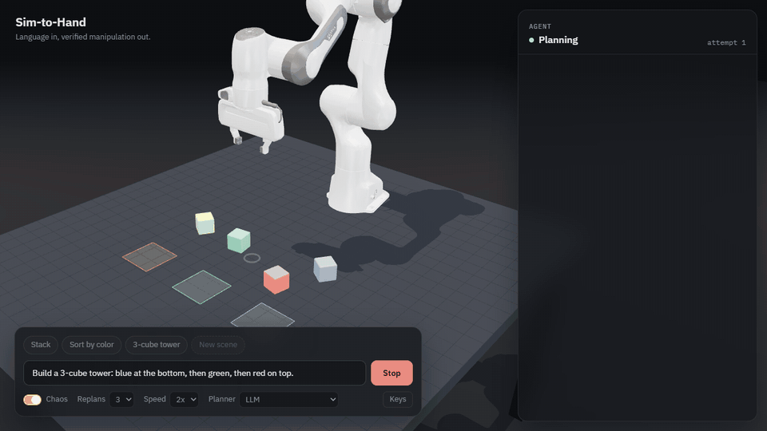
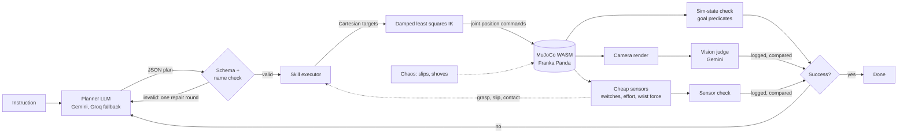
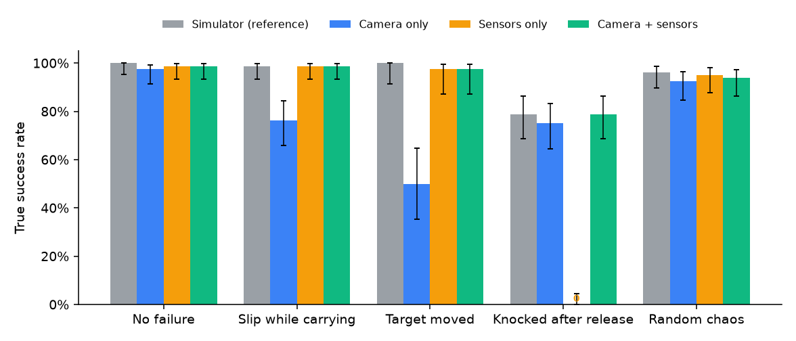
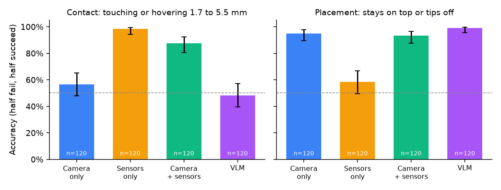

# Sim-to-Hand

An AI agent for robot manipulation. Type a tabletop task in plain English: an LLM plans it, MuJoCo runs it in your browser, three independent checks verify it (simulator state, a vision model, and cheap touch and force sensors), and the agent replans when it fails. A built-in study shows why the sensor check is there: free vision models miss millimeter-scale contact failures.

**Live demo:** https://sim-to-hand.vercel.app · **Research benchmark and game:** https://sim-to-hand.vercel.app/benchmark/ · **Report:** [research/report/report.pdf](research/report/report.pdf) · **Dataset:** https://huggingface.co/datasets/lilizzz4444/vision-cant-feel



## What it does

- A Franka Panda arm, a table, colored cubes and three colored zones, simulated with the official MuJoCo WebAssembly build.
- Presets: stack two cubes, sort by color, build a 3-cube tower. Or type any instruction.
- The LLM only picks from five skills: `move_to`, `grasp`, `lift`, `place`, `release`. It never outputs joint angles or torques. Inverse kinematics does the low-level control.
- After each attempt, three checks run side by side:
  1. **Sim state:** goal predicates checked against true cube poses.
  2. **Vision:** a fixed camera render goes to Gemini with the question "did the task succeed?".
  3. **Sensors:** what the robot itself felt, through cheap, noisy sensors: a contact switch on each fingertip, gripper effort (a motor-current proxy) and a single-axis wrist force. Every grasp must be felt and every placement must register as a force spike.
  All verdicts are shown. Disagreements are flagged and logged. Sim state decides success.
- On failure the agent replans with the error, the current scene and the camera image (up to N times).
- **Chaos** mode makes grasps slip and shoves cubes, so you can watch it recover.

## Architecture



Keys never reach the browser bundle. Without a visitor key, the browser calls `/api/llm`, a Vercel function that holds the keys, only accepts the two request types this app makes (plan, judge), caps payload sizes, and rate limits per IP and per day. With a visitor key ("Keys" button), requests go straight from the browser to Google or Groq and the key stays in that browser's localStorage.

## Agent loop

1. **Plan.** The planner gets the instruction and a text description of the scene (cube positions, what rests on what, zones, gripper state). It returns `{reasoning, goal, steps}`. `goal` is a list of predicates: `on(a, b)` or `in_zone(a, zone)`. The output is validated with a JSON Schema (Ajv) and every name is checked against the scene. Invalid output gets one repair round with the errors fed back.
2. **Execute.** Each skill is a sequence of minimum-jerk Cartesian moves. A damped least squares IK solver with a null-space posture term turns them into joint targets for the Panda's position actuators. Skills check themselves with the cheap sensors, not with true object poses: a grasp must close both fingertip switches with gripper effort above 5 N, a slip shows up as the switches going off, and a placement lowers under a force guard until the wrist force jumps. The sensor model adds noise, 8 to 10 bit quantization, a fixed offset, 2% switch flips and 2% dropped reads.
3. **Verify.** The arm moves out of view, the scene settles, then all three checks run. For presets and benchmark tasks the goal comes from the task definition. For free text it comes from the planner's own `goal`, so sim-state checking free text is only as good as the planner's reading of the instruction.
4. **Replan.** The failure reason, the camera's verdict and the camera image (Gemini only) go back to the planner along with the new scene state. It plans only what is left.

## Benchmark

24 seeded tasks: 9 stack, 6 tower, 4 sort, 5 zone. Instructions use varied phrasing. Each task runs in four conditions. Max 3 replans. Chaos: slip probability 0.2 per transport skill, nudge probability 0.12 between steps, at most 2 events per attempt. Chaos is seeded per task, so both chaos rows see the same events on their first attempt.

- `scripted`: no LLM. Plans come straight from the task's goal predicates. Isolates executor reliability. On retry it repeats the full sequence, with no reasoning about the new state.
- `llm`: LLM planner plus vision judge. Ground truth for success always comes from sim state.

| Condition | Tasks | Success | Avg replans | Avg chaos events | Vision agrees with sim | Sensors agree with sim | LLM calls |
|---|---|---|---|---|---|---|---|
| scripted | 24 | 24/24 (100%) | 0.00 | 0.00 | not run | 24/24 (100%) | 0 |
| scripted-chaos | 24 | 21/24 (88%) | 0.88 | 2.17 | not run | 43/45 (96%) | 0 |
| llm | 24 | 24/24 (100%) | 0.00 | 0.00 | 24/24 (100%) | not run* | 48 |
| llm-chaos | 24 | 22/24 (92%) | 0.88 | 2.17 | 45/45 (100%) | not run* | 90 |

*The LLM rows come from a run made before the sensor check existed (raw data kept in [bench/results-llm-before-sensors.json](bench/results-llm-before-sensors.json)); the scripted rows were rerun with sensors and still pass at the same rates, so the sensor-driven executor kept the same reliability. The two sensor disagreements under chaos are cases sensors cannot see: a cube knocked off after it was released.

| Condition | stack | tower | sort | zone |
|---|---|---|---|---|
| scripted | 9/9 | 6/6 | 4/4 | 5/5 |
| scripted-chaos | 9/9 | 3/6 | 4/4 | 5/5 |
| llm | 9/9 | 6/6 | 4/4 | 5/5 |
| llm-chaos | 9/9 | 4/6 | 4/4 | 5/5 |

Calls by provider: gemini-3.1-flash-lite 117, gemini-3.5-flash-lite 20 (fallback), groq gpt-oss-120b 1 (fallback).

Reading:

- Without chaos, every plan was valid and every task succeeded on the first attempt, in both conditions.
- With chaos, all failures are towers. The LLM planner recovered one tower the scripted baseline did not (22/24 vs 21/24). That is one task; the difference is small.
- The two LLM failures (tower-03, tower-06) used all 4 attempts and still lost a cube to an injected slip on the last one.
- The vision check agreed with sim state on all 69 checks. No disagreements were logged, so this benchmark does not show where vision fails. The camera is fixed and the failures here are large (cubes centimeters apart), which is the easy case for vision.

Raw per-task data: [bench/results.json](bench/results.json). Summary and failure list: [bench/RESULTS.md](bench/RESULTS.md). Reproduce with `npm run bench` (needs keys in `.env`; free-tier rate limits make the LLM rows take about an hour).

## Do the touch sensors add value? 1,600 seeded episodes

The 24-task benchmark is small, so I ran a controlled experiment: 80 generated tasks (`generateTasks(20, 1000)`), the scripted planner (no LLM calls, so runs are free and repeatable), and up to 3 replans. Each task ran under 20 conditions: 4 decision rules times 5 failure types. Every episode and every attempt is saved to CSV. Every rate below has a 95% Wilson confidence interval.

**Decision rules**, meaning what the agent trusts to say "done":

- **Camera only:** an OpenCV detector ([research/vcf/detect.py](research/vcf/detect.py)) finds each cube by color, fits its 3D pose by matching projected silhouettes, and checks the goal geometry. The robot runs open loop, with no touch or force sensing.
- **Sensors only:** the cheap fingertip switches, gripper effort and wrist force.
- **Camera + sensors:** done only when both agree.
- **Simulator:** the reference. It reads true cube poses, which a real robot cannot do.

Scoring always uses true simulator state.

**Failures**, injected deterministically in the first attempt: the cube slips while carried, the target cube moves just before placing, or the cube is knocked away right after release. Seeded random chaos and a no-failure baseline are also included.

| Failure | Camera only | Sensors only | Camera + sensors | Simulator |
|---|---|---|---|---|
| None (80) | 98% | 99% | 99% | 100% |
| Slip while carrying (80) | 76% | 99% | 99% | 99% |
| Target moved (40, stack and tower only) | 50% | 98% | 98% | 100% |
| Knocked after release (80) | 75% | **0%, all 80 falsely declared done** | 79% | 79% |
| Random chaos (80) | 92% | 95% | 94% | 96% |

The table shows the true success rate. Takeaways:

- **Sensors catch failures during the task.** A dropped cube is noticed 5.4 s into the attempt, vs 15.4 s for the camera-only agent, which only looks at the end. Without touch, the open-loop robot also gets stuck more often: it recovered from 69% of real slips vs 99% with sensors.
- **The camera catches what sensors cannot feel.** After a release, the hand feels nothing, so sensors alone declared all 80 knocked-off episodes a success.
- **Camera + sensors never stopped early on a failure.** It had 0 false successes in all 360 of its episodes, and matched the simulator reference on true success in every failure type, within the confidence intervals. The cost is extra replans when the camera rejects a good attempt: 2.2 attempts on average vs 2.0 for sensors alone on slips.



### Cases built so the camera cannot tell

Minimal pairs from the agent's own robot and cubes: 120 per type, half success and half failure by construction.

| Checkpoint | Camera (OpenCV) | Vision-language model (Gemini 3.1 Flash-Lite) | Sensors | Camera + sensors |
|---|---|---|---|---|
| **Contact:** held cube touching vs hovering 1.7 to 5.5 mm | 57% [48, 65] | 48% [40, 57] | **98%** [94, 100] | 88% [80, 92] |
| **Placement:** cube stays on top vs tips off after release | 95% [90, 98] | 99% [95, 100] | 58% [49, 67] | 93% [87, 97] |

Accuracy with 95% intervals; chance is 50%.

- Millimeter contact is invisible to both camera methods. They are near chance and pass 64% (OpenCV) and 79% (Gemini) of the hovering cases as touching. The wrist force sensor gets 98%.
- The opposite holds after the hand lets go: sensors cannot see a cube tip off, and both camera methods can.
- Combining them keeps false successes at 3% (contact) and 0% (placement).



All tables, plus recovery rates, time to detect and the per-gap contact curve: [experiments/RESULTS.md](experiments/RESULTS.md). Raw logs: [experiments/data](experiments/data). The plots are drawn only from those CSVs, by `research/scripts/analyze_experiments.py`.

## Why the sensor check: the research behind it

The agent's vision check agreed with the simulator on all 69 checks above, because those failures were centimeters apart. [research/](research/) asks what happens at the millimeter scale where contact decides success. It builds minimal pairs in MuJoCo, the same scene captured as a success and as a failure a few millimeters off, across five contact tasks (stack, grasp, button, peg, push). It then compares free vision models with a tiny classifier on the same cheap sensors the agent uses.

| Judge (400 samples, 200 pairs) | Balanced accuracy | Failures called a success |
|---|---|---|
| Cheap-sensor classifier (logistic regression) | 0.89 | 11% |
| Gemini 3.1 Flash-Lite, image only (150/400 answered, free quota) | 0.55 | 53% |

- Some vision models still call a stack a success with the cube hovering 7 to 16 mm above it.
- Sensors are not a full fix. A single-axis wrist force cannot feel a sideways push (the push task stays at chance), the classifier does not transfer to unseen tasks, and vision catches up at 32x the default sensor noise.
- That is why the agent uses sensors for per-skill checks (grasp, slip, contact) rather than a learned success classifier, and keeps all three verdicts visible.

Play "Can you tell?" and see every model's answers at https://sim-to-hand.vercel.app/benchmark/. Full results, attacker, limitations and reproduction: [research/README.md](research/README.md). Related work: [research/RELATED_WORK.md](research/RELATED_WORK.md).

## Physics engine choice

I compared MuJoCo WASM, Rapier and cannon-es before building.

- **MuJoCo** (`@mujoco/mujoco`, the official Google DeepMind build): soft-contact solver built for robotics, elliptic friction cones, and the Menagerie Panda model with tuned actuators. The same WASM runs in Node, so the executor is tested headless (`npm run test:sim`). Cost: about 2.7 MB gzipped.
- **Rapier, cannon-es:** game engines. Friction grasps with a parallel gripper tend to jitter or slide, and most demos fake grasps by attaching the object. That would make "grasp slipped" meaningless. cannon-es has not been released since 2022.

Picked MuJoCo. The npm README calls Windows support experimental; it ran without issues here in Node 22 and in Edge and Chrome.

## Limitations

- Sim only. No sim-to-real transfer is attempted or claimed.
- The workspace is fixed: 5 cm cubes, four colors, three zones. The skill library has no push, rotate or unstack-from-under primitives.
- Gripper strength was raised from the Menagerie default and gravity compensation is on, to keep grasps stable. Chaos slips are injected by briefly opening the gripper, not by a friction model.
- The vision check sees one fixed camera at 640x480. Small offsets that the sim-state check catches can look fine in the image.
- Free-text tasks are verified against the planner's own goal predicates, not an independent spec.
- The proxy's rate limit lives in function memory, so it is per instance and resets on cold starts. It is basic abuse protection, not a quota system.
- Free LLM tiers have daily limits. When the shared key runs out, add your own key or come back tomorrow.
- The agent's sensors are simulated and degraded with a simple noise model. Real touch and force sensors are messier.
- The sensor check cannot see what happens after a release, such as a cube knocked off a stack. Sim state still decides success.
- The planner still reads cube positions from the simulator. The OpenCV detector is used to verify results in the experiments, not to plan.
- The camera-only rule in the experiments uses one fixed, calibrated camera, known cube sizes and distinct colors. Its contact result is a property of this camera and resolution: a closer or second camera could see some of the gaps it misses here.
- The experiments use a scripted planner, so they measure checking and recovery, not LLM planning. The simulator rule still uses touch and force sensing during skills; only its final verdict reads true poses.
- Failures are injected by teleporting cubes or briefly opening the gripper, not by modeled physical causes. Hover gaps came out 1.3 mm larger than commanded because the arm sags; the tables use the measured gaps.
- The research study's vision numbers come from free tiers with partial coverage for several models; see [research/README.md](research/README.md).

## Run locally

Requires Node 22+.

```bash
git clone https://github.com/Anya-Louni/sim-to-hand && cd sim-to-hand
npm install
cp .env.example .env   # add GEMINI_API_KEY and/or GROQ_API_KEY
npm run dev
```

Open http://localhost:5173. The dev server serves `/api/llm` with the same handler as production.

Other scripts:

```bash
npm run test:sim      # headless scripted episodes in Node
npm run bench         # full benchmark in headless Edge or Chrome, writes bench/ (LLM answers cached in bench/llm-cache)
npm run trials -- checkpoints 60   # minimal pairs, writes experiments/data
npm run trials -- trials 20        # 1,600 seeded episodes, about 30 min on 6 headless pages; resumes if stopped
npm run model         # rebuild public/models from MuJoCo Menagerie (clone franka_emika_panda into vendor/panda first)
```

Research study (Python 3.11+):

```bash
cd research
pip install -r requirements.txt
cp .env.example .env    # free GEMINI_API_KEY and GROQ_API_KEY; Ollama for local models
sh reproduce.sh         # regenerates data, runs judges and attacker, rebuilds the site data in public/benchmark
```

Experiment analysis (needs `opencv-python-headless`, CPU only):

```bash
python research/scripts/judge_checkpoints.py                              # OpenCV camera check on every checkpoint image
python research/scripts/judge_checkpoints.py gemini/gemini-3.1-flash-lite # optional VLM, cached, free tier
python research/scripts/analyze_experiments.py                            # tables, confidence intervals, plots
```

## Credits

Franka Panda model from [MuJoCo Menagerie](https://github.com/google-deepmind/mujoco_menagerie) (Apache-2.0, see `public/models/LICENSE-panda.txt`), decimated for the web. Physics by [MuJoCo](https://github.com/google-deepmind/mujoco). Rendering by [Three.js](https://threejs.org).

## License

Code: MIT. Research dataset: CC BY 4.0. Robot model: Apache-2.0.
