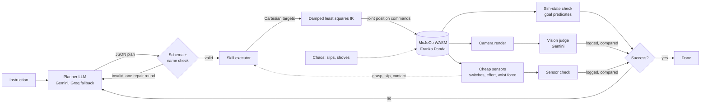
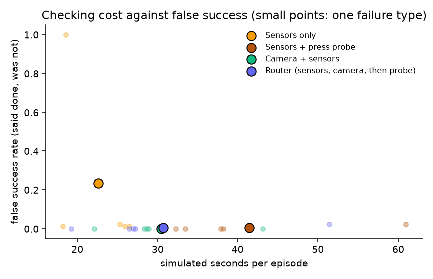

# Sim-to-Hand

[](https://github.com/Anya-Louni/sim-to-hand/actions/workflows/ci.yml)

An AI agent for robot manipulation. Type a tabletop task in plain English: an LLM plans it, MuJoCo runs it in your browser, three independent checks verify it (simulator state, a vision model, and cheap touch and force sensors), and the agent replans when it fails. A built-in study shows why the sensor check is there: free vision models miss millimeter-scale contact failures.

**Live demo:** https://sim-to-hand.vercel.app · **Research benchmark and games:** https://sim-to-hand.vercel.app/benchmark/ · **Report:** [research/report/report.pdf](research/report/report.pdf) · **Dataset:** https://huggingface.co/datasets/lilizzz4444/vision-cant-feel · **Runbook:** [docs/RUNBOOK.md](docs/RUNBOOK.md) · **Changes:** [CHANGELOG.md](CHANGELOG.md)

## Contents

- [What it does](#what-it-does), [architecture](#architecture), [agent loop](#agent-loop)
- [Benchmark](#benchmark) and the [harder suite](#harder-suite-relational-reorder-impossible-and-distractor-tasks)
- Experiments, all seeded and free to rerun: [who decides "done"](#do-the-touch-sensors-add-value-1600-seeded-episodes), [cases built for the camera to miss](#cases-built-so-the-camera-cannot-tell), [planning from what the camera sees](#planning-from-what-the-camera-sees), [touching the result before saying done](#active-verification-touch-the-result-before-saying-done), [a 6-axis wrist sensor](#does-a-6-axis-wrist-sensor-help), [can a language model read a touch trace](#can-a-language-model-read-a-touch-trace)
- [The research behind the sensor check](#why-the-sensor-check-the-research-behind-it), [limitations](#limitations), [reproduce](#reproduce-every-number), [run locally](#run-locally), [cite](#cite)

Every number in this README, the report and the website is written by a script from raw data in the repo (`npm run results`); CI fails if a committed number no longer matches its data.


## What it does

- A Franka Panda arm, a table, colored cubes and three colored zones, simulated with the official MuJoCo WebAssembly build.
- Presets: stack two cubes, sort by color, build a 3-cube tower. Or type any instruction.
- The LLM only picks from five skills: `move_to`, `grasp`, `lift`, `place`, `release`. It never outputs joint angles or torques. Inverse kinematics does the low-level control.
- After each attempt, three checks run side by side:
  1. **Sim state:** goal predicates checked against true cube poses.
  2. **Vision:** a fixed camera render goes to Gemini with the question "did the task succeed?".
  3. **Sensors:** what the robot itself felt, through cheap, noisy sensors: a contact switch on each fingertip, gripper effort (a motor-current proxy) and a single-axis wrist force. Every grasp must be felt and every placement must register as a force spike.
  All verdicts are shown. Disagreements are flagged and logged. Sim state decides success.
- On failure the agent replans with the error, the current scene and the camera image (up to N times).
- **Chaos** mode makes grasps slip and shoves cubes, so you can watch it recover.

## Architecture



Keys never reach the browser bundle. Without a visitor key, the browser calls `/api/llm`, a Vercel function that holds the keys, only accepts the two request types this app makes (plan, judge), caps payload sizes, and rate limits per IP and per day. With a visitor key ("Keys" button), requests go straight from the browser to Google or Groq and the key stays in that browser's localStorage.

## Agent loop

1. **Plan.** The planner gets the instruction and a text description of the scene (cube positions, what rests on what, zones, gripper state). It returns `{reasoning, goal, steps}`. `goal` is a list of predicates: `on(a, b)` or `in_zone(a, zone)`. The output is validated with a JSON Schema (Ajv) and every name is checked against the scene. Invalid output gets one repair round with the errors fed back.
2. **Execute.** Each skill is a sequence of minimum-jerk Cartesian moves. A damped least squares IK solver with a null-space posture term turns them into joint targets for the Panda's position actuators. Skills check themselves with the cheap sensors, not with true object poses: a grasp must close both fingertip switches with gripper effort above 5 N, a slip shows up as the switches going off, and a placement lowers under a force guard until the wrist force jumps. The sensor model adds noise, 8 to 10 bit quantization, a fixed offset, 2% switch flips and 2% dropped reads.
3. **Verify.** The arm moves out of view, the scene settles, then all three checks run. For presets and benchmark tasks the goal comes from the task definition. For free text it comes from the planner's own `goal`, so sim-state checking free text is only as good as the planner's reading of the instruction.
4. **Replan.** The failure reason, the camera's verdict and the camera image (Gemini only) go back to the planner along with the new scene state. It plans only what is left.

## Benchmark

<!-- BEGIN:bench_intro -->
24 seeded tasks: 9 stack, 6 tower, 4 sort, 5 zone. Instructions use varied phrasing. Each task runs in four conditions. Max 3 replans.
<!-- END:bench_intro -->
Chaos: slip probability 0.2 per transport skill, nudge probability 0.12 between steps, at most 2 events per attempt. Chaos is seeded per task, so both chaos rows see the same events on their first attempt.

- `scripted`: no LLM. Plans come straight from the task's goal predicates. Isolates executor reliability. On retry it repeats the full sequence, with no reasoning about the new state.
- `llm`: LLM planner plus vision judge. Ground truth for success always comes from sim state.

<!-- BEGIN:bench -->
Brackets are 95% Wilson confidence intervals.

| Condition | Tasks | Success | Avg replans | Avg chaos events | Vision agrees with sim | Sensors agree with sim | LLM calls |
|---|---|---|---|---|---|---|---|
| scripted | 24 | 24/24 = 100% [86, 100] | 0.00 | 0.00 | not run | 24/24 = 100% [86, 100] | 0 |
| scripted-chaos | 24 | 21/24 = 88% [69, 96] | 0.88 | 2.17 | not run | 43/45 = 96% [85, 99] | 0 |
| llm | 24 | 24/24 = 100% [86, 100] | 0.00 | 0.00 | 24/24 = 100% [86, 100] | 24/24 = 100% [86, 100] | 48 |
| llm-chaos | 24 | 22/24 = 92% [74, 98] | 0.88 | 2.13 | 45/45 = 100% [92, 100] | 44/45 = 98% [88, 100] | 90 |

Per-kind success:

| Condition | stack | tower | sort | zone |
|---|---|---|---|---|
| scripted | 9/9 | 6/6 | 4/4 | 5/5 |
| scripted-chaos | 9/9 | 3/6 | 4/4 | 5/5 |
| llm | 9/9 | 6/6 | 4/4 | 5/5 |
| llm-chaos | 9/9 | 4/6 | 4/4 | 5/5 |

Calls by provider: gemini/gemini-3.1-flash-lite 15, gemini/gemini-3.5-flash-lite 123

- Without chaos: scripted 24/24 (24 on the first attempt), LLM 24/24 (24 on the first attempt).
- With chaos: scripted 21/24, LLM 22/24. Failed kinds: scripted tower; LLM tower. The intervals overlap, so this benchmark does not separate the planners.
- The vision check agreed with sim state on 69 of 69 checks. The camera is fixed and the failures here are centimeters apart, which is the easy case for vision.
<!-- END:bench -->

All four rows were run with the current executor (sensor checks during skills) and the current planner prompt. Earlier runs are kept: [bench/results-before-a3.json](bench/results-before-a3.json) and [bench/results-llm-before-sensors.json](bench/results-llm-before-sensors.json). The LLM calls of every run are cached in `bench/llm-cache`, keyed by the request and the system prompts, so rerunning replays them for free.

Raw per-task data: [bench/results.json](bench/results.json). Summary and failure list: [bench/RESULTS.md](bench/RESULTS.md). Reproduce with `npm run bench` (needs keys in `.env`; free-tier rate limits make the LLM rows take about an hour).

### Harder suite: relational, reorder, impossible and distractor tasks

20 hand-written tasks in four families, five each: the target is named by where it is ("the cube closest to the robot base"); cubes start stacked and must be reordered; the task cannot be done (a purple cube, an orange zone, a cube on itself, contradictory goals), where the right answer is a structured refusal (`{"refuse": "<why>"}` in the plan schema); and instructions with corrections or negations ("Not the red cube, I mean the green one"). Goals are written by hand. Correct means the goal holds at the end, or the planner refused an impossible task.

<!-- BEGIN:hard -->
| Condition | relational | reorder | impossible | distractor | Correct [95% CI] | Refused a possible task | Tried an impossible task |
|---|---|---|---|---|---|---|---|
| scripted | 5/5 | 4/5 | 5/5 | 5/5 | 19/20 = 95% [76, 99] | 0/15 | 0/5 |
| scripted-chaos | 5/5 | 4/5 | 5/5 | 5/5 | 19/20 = 95% [76, 99] | 0/15 | 0/5 |
| llm | 5/5 | 4/5 | 5/5 | 5/5 | 19/20 = 95% [76, 99] | 0/15 | 0/5 |
| llm-chaos | 4/5 | 4/5 | 5/5 | 5/5 | 18/20 = 90% [70, 97] | 0/15 | 0/5 |

The scripted rows plan from the hand-written goal, so they read the answer key: they refuse impossible tasks because the goal is empty, and they never plan an unstack. They pass reorder tasks that start stacked only when the first grasp lifts the whole stack, the placement feels no contact, the top cube falls off, and the retry works.
<!-- END:hard -->

These tasks turned out easier for the LLM planner than intended: it refused every impossible task with the right reason and never refused a possible one. Its remaining failures are execution failures on the reverse-tower task and one empty replan under chaos. Raw data: [bench/results_hard.json](bench/results_hard.json); failures and refusal texts: [bench/RESULTS_HARD.md](bench/RESULTS_HARD.md). Run with `SUITE=hard npm run bench`.

## Do the touch sensors add value? 1,600 seeded episodes

<!-- BEGIN:trials_intro -->
The 24-task benchmark is small, so I ran a controlled experiment: 80 generated tasks (`generateTasks(20, 1000)`), the scripted planner (no LLM calls, so runs are free and repeatable), and up to 3 replans. Each task ran under 20 conditions: 4 decision rules times 5 failure types. Every episode and every attempt is saved to CSV. Every rate below has a 95% Wilson confidence interval.
<!-- END:trials_intro -->

**Decision rules**, meaning what the agent trusts to say "done":

- **Camera only:** an OpenCV detector ([research/vcf/detect.py](research/vcf/detect.py)) finds each cube by color, fits its 3D pose by matching projected silhouettes, and checks the goal geometry. The robot runs open loop, with no touch or force sensing.
- **Sensors only:** the cheap fingertip switches, gripper effort and wrist force.
- **Camera + sensors:** done only when both agree.
- **Simulator:** the reference. It reads true cube poses, which a real robot cannot do.

Scoring always uses true simulator state.

**Failures**, injected deterministically in the first attempt: the cube slips while carried, the target cube moves just before placing, or the cube is knocked away right after release. Seeded random chaos and a no-failure baseline are also included.

<!-- BEGIN:trials -->
| Failure | Camera only | Sensors only | Camera + sensors | Simulator |
|---|---|---|---|---|
| None (80) | 98% [91, 99] | 99% [93, 100] | 99% [93, 100] | 100% [95, 100] |
| Slip while carrying (80) | 76% [66, 84] | 99% [93, 100] | 99% [93, 100] | 99% [93, 100] |
| Target moved (40, stack and tower only) | 50% [35, 65] | 98% [87, 100] | 98% [87, 100] | 100% [91, 100] |
| Knocked after release (80) | 75% [65, 83] | **0% [0, 5], all 80 falsely declared done** | 79% [69, 86] | 79% [69, 86] |
| Random chaos (80) | 93% [85, 97] | 95% [88, 98] | 94% [86, 97] | 96% [90, 99] |

The table shows the true success rate. Takeaways:

- **Sensors catch failures during the task.** A dropped cube is noticed 5.4 s into the attempt, vs 15.4 s for the camera-only agent, which only looks at the end. Without touch, the open-loop robot also gets stuck more often: it recovered from 69% [58, 79] of real slips vs 99% [93, 100] with sensors.
- **The camera catches what sensors cannot feel.** After a release, the hand feels nothing, so sensors alone declared 80 of 80 knocked-off episodes a success.
- **Camera + sensors never stopped early on a failure.** It had 0 false successes in 360 episodes (0% [0, 1]), and its true success overlapped the simulator reference within 95% intervals in every failure type. The cost is extra replans when the camera rejects a good attempt: 2.2 attempts on average vs 2.0 for sensors alone on slips.
<!-- END:trials -->


### Cases built so the camera cannot tell

<!-- BEGIN:checkpoints -->
Minimal pairs from the agent's own robot and cubes: 120 per type, half success and half failure by construction.

| Checkpoint | Camera (OpenCV) | Vision-language model (gemini-3.1-flash-lite) | Sensors | Camera + sensors |
|---|---|---|---|---|
| **Contact:** held cube touching vs hovering 1.7 to 5.5 mm | 57% [48, 65] | 48% [40, 57] | **98% [94, 100]** | 88% [80, 92] |
| **Placement:** cube stays on top vs tips off after release | 95% [90, 98] | 99% [95, 100] | 58% [49, 67] | 93% [87, 97] |

Accuracy with 95% Wilson intervals; chance is 50%.

- Millimeter contact is hard for both camera methods. They pass 64% [51, 75] (OpenCV) and 79% [67, 87] (VLM) of the hovering cases as touching. The wrist force sensor is right on 98% [94, 100] of contact checkpoints.
- The opposite holds after the hand lets go: sensors pass 87% [76, 94] of tipped cubes as placed, the camera 0% [0, 7].
- Combining them keeps false successes at 3% [1, 11] (contact) and 0% [0, 7] (placement).
<!-- END:checkpoints -->


### Planning from what the camera sees

In every experiment above the robot aims its moves at the simulator's true cube poses, which a real robot does not have. In perceived-state mode it aims at the poses the OpenCV detector fits in the camera image instead, looked up again before every attempt. Where it puts a cube down, it assumes the cube is now there. Same 80 tasks; scoring still uses true state.

<!-- BEGIN:perceived -->
| Decider | Failure | True success, perceived state | True success, true state | McNemar p |
|---|---|---|---|---|
| Simulator | no failure | 100% [95, 100] | 100% [95, 100] | 1.000 |
| Sensors only | no failure | 99% [93, 100] | 99% [93, 100] | 1.000 |
| Camera + sensors | no failure | 93% [85, 97] | 99% [93, 100] | 0.063 |
| Camera + sensors | random chaos | 90% [81, 95] | 94% [86, 97] | 0.250 |

Camera position error over 443 looks: median 2.4 mm, mean 4.7 mm, worst cube in a look up to 184 mm. Looks where a cube was not found: 5.
<!-- END:perceived -->

The executor tolerates a few millimeters of camera error because grasps close on the cube and placements stop on contact. None of the differences above are significant at 0.05, though camera + sensors loses a few episodes it won with true state. Try it locally with the "Camera state" toggle in `npm run dev`. The deployed site has no Python detector, so the toggle is hidden there.

### Active verification: touch the result before saying done

Sensors go blind at release, which is why sensors alone declared every knocked-off cube a success. The press probe ([design note](docs/design/active_verification.md)) lowers the closed gripper onto where the robot put each top cube and checks with the cheap force reading and the arm's own height that the top face is there. The router runs the checks from cheapest to dearest: the sensors; the camera, only if the sensors pass; the probe, only if the camera then disagrees.

<!-- BEGIN:probes -->
| Strategy | True success | False success | False success, knocked after release | Sim s / episode | Camera checks / episode | Probes / episode |
|---|---|---|---|---|---|---|
| Sensors only | 76% [71, 80] | 23% [19, 28] | 100% [95, 100] | 22.6 | 0.00 | 0.00 |
| Sensors + press probe | 95% [92, 97] | 1% [0, 2] | 3% [1, 9] | 41.5 | 0.00 | 1.92 |
| Camera + sensors | 93% [90, 95] | 0% [0, 1] | 0% [0, 5] | 30.4 | 2.07 | 0.00 |
| Router | 95% [92, 97] | 1% [0, 2] | 3% [1, 9] | 30.7 | 1.19 | 0.45 |

All five failure types pooled (360 episodes per strategy). Per failure type: [experiments/RESULTS.md](experiments/RESULTS.md), section 4.
<!-- END:probes -->

- The probe closes the blind spot after release: on knocked-off cubes false success falls from every episode with sensors alone to the few in the table. The remaining misses are towers with the cubes at the right height in the wrong order; a press cannot tell which cube is underneath, a camera can.
- The router matches sensors + probe on true and false success, and costs about as much time as camera + sensors, with fewer camera checks. Camera + sensors still has the fewest false successes.
- The first probe design missed towers rebuilt on a knocked-off middle cube; that run is kept and reported in [experiments/RESULTS.md](experiments/RESULTS.md).



### Does a 6-axis wrist sensor help?

The research classifier uses one wrist force axis. A cheap 6-axis force/torque sensor (same noise model on every axis) was added to the simulator and to the dataset by replaying every committed attempt; the replayed single-axis traces matched the committed ones exactly. The features are task-agnostic: contact onset time, peak change, direction relative to the approach, steadiness after onset, and torque.

<!-- BEGIN:ft -->
| Test set | Classifier | Single axis [95% CI] | 6-axis F/T [95% CI] | McNemar (6-axis better / single better, p) |
|---|---|---|---|---|
| small (100) | sensor_logreg | 0.86 [0.78, 0.93] | 0.90 [0.84, 0.96] | 11 / 7, p 0.481 |
| small (100) | sensor_gboost | 0.86 [0.78, 0.93] | 0.95 [0.89, 1.00] | 11 / 2, p 0.022 |
| large (400) | sensor_logreg | 0.89 [0.85, 0.92] | 0.96 [0.94, 0.98] | 41 / 12, p < 0.001 |
| large (400) | sensor_gboost | 0.89 [0.85, 0.92] | 0.96 [0.94, 0.98] | 36 / 6, p < 0.001 |

Held-out task (large set, logistic regression), single axis to 6-axis: stack 0.50 to 0.89, grasp 1.00 to 1.00, button 0.66 to 0.54, peg 0.50 to 0.86, push 0.50 to 0.50. The 6-axis advantage is gone from noise strength 2x: the intervals overlap from there on. Full tables: [research/results/ft_ablation.md](research/results/ft_ablation.md).
<!-- END:ft -->

### Can a language model read a touch trace?

Each small-set sample's cheap-sensor trace (the same noisy signals the classifier sees, printed at 10 Hz) goes to a text-only model with the task description. One-shot adds one labelled success and failure of the same task from the training seeds. The "Can you feel it?" game on the [benchmark site](https://sim-to-hand.vercel.app/benchmark/#feel) asks people the same question.

<!-- BEGIN:trace_llm -->
| Reader (small set) | Answered | Balanced acc. [95% CI] | False-success [95% CI] | vs sensor classifier (only LLM / only classifier right, p) |
|---|---|---|---|---|
| groq/openai/gpt-oss-120b (0-shot) | 100 | 0.68 [0.58, 0.78] | 18% [8, 30] | 9 / 27, p 0.005 |
| groq/openai/gpt-oss-120b (1-shot) | 96 | 0.91 [0.83, 0.97] | 10% [2, 19] | 6 / 2, p 0.289 |
<!-- END:trace_llm -->

Without an example the model is worse than the classifier. With one labelled pair of the same task it is not significantly different from the classifier, and on the same samples it beats the camera VLM by a wide margin: [research/results/trace_llm.md](research/results/trace_llm.md). The one-shot run stopped a few samples short (Answered column) on the free tier's daily token limit.

All tables, plus recovery rates, time to detect and the per-gap contact curve: [experiments/RESULTS.md](experiments/RESULTS.md). Raw logs: [experiments/data](experiments/data). The plots are drawn only from those CSVs, by `research/scripts/analyze_experiments.py`.

## Why the sensor check: the research behind it

<!-- BEGIN:research -->
The agent's vision check agreed with the simulator on 69 of 69 checks above, because those failures were centimeters apart. [research/](research/) asks what happens at the millimeter scale where contact decides success. It builds minimal pairs in MuJoCo, the same scene captured as a success and as a failure a few millimeters off, across five contact tasks (stack, grasp, button, peg, push). It then compares free vision models with a tiny classifier on the same cheap sensors the agent uses.

| Judge (400 samples, 200 pairs) | Balanced accuracy [95% CI] | Failures called a success [95% CI] |
|---|---|---|
| Cheap-sensor classifier (logistic regression) | 0.89 [0.85, 0.92] | 11% [7, 16] |
| gemini-3.1-flash-lite, image only (164/400 answered, free quota) | 0.55 [0.50, 0.60] | 54% [43, 65] |

Intervals resample minimal pairs (2,000 bootstrap resamples). A paired McNemar test on the 164 shared samples gives p < 0.001.

- Some vision models still call a stack a success with the cube hovering 7 to 16 mm above it.
- Sensors are not a full fix. A single-axis wrist force cannot feel a sideways push (the push task scores 0.50), the classifier does not transfer to unseen tasks, and vision's interval overlaps the sensors' from noise strength 16x the default and its point estimate is higher from 32x.
- That is why the agent uses sensors for per-skill checks (grasp, slip, contact) rather than a learned success classifier, and keeps all three verdicts visible.
<!-- END:research -->

Play "Can you tell?" and see every model's answers at https://sim-to-hand.vercel.app/benchmark/. Full results, attacker, limitations and reproduction: [research/README.md](research/README.md). Related work: [research/RELATED_WORK.md](research/RELATED_WORK.md).

## Physics engine choice

I compared MuJoCo WASM, Rapier and cannon-es before building.

- **MuJoCo** (`@mujoco/mujoco`, the official Google DeepMind build): soft-contact solver built for robotics, elliptic friction cones, and the Menagerie Panda model with tuned actuators. The same WASM runs in Node, so the executor is tested headless (`npm run test:sim`). Cost: about 2.7 MB gzipped.
- **Rapier, cannon-es:** game engines. Friction grasps with a parallel gripper tend to jitter or slide, and most demos fake grasps by attaching the object. That would make "grasp slipped" meaningless. cannon-es has not been released since 2022.

Picked MuJoCo. The npm README calls Windows support experimental; it ran without issues here in Node 22 and in Edge and Chrome.

## Limitations

- Sim only. No sim-to-real transfer is attempted or claimed.
- The workspace is fixed: 5 cm cubes, four colors, three zones. The skill library has no push, rotate or unstack-from-under primitives.
- Gripper strength was raised from the Menagerie default and gravity compensation is on, to keep grasps stable. Chaos slips are injected by briefly opening the gripper, not by a friction model.
- The vision check sees one fixed camera at 640x480. Small offsets that the sim-state check catches can look fine in the image.
- Free-text tasks are verified against the planner's own goal predicates, not an independent spec.
- The proxy's rate limit lives in function memory, so it is per instance and resets on cold starts. It is basic abuse protection, not a quota system.
- Free LLM tiers have daily limits. When the shared key runs out, add your own key or come back tomorrow.
- The agent's sensors are simulated and degraded with a simple noise model. Real touch and force sensors are messier.
- The sensor check cannot see what happens after a release, such as a cube knocked off a stack. The press probe covers that case in the experiments but is not used in the live demo.
- By default the planner and skills read cube positions from the simulator. Perceived-state mode replaces them with OpenCV estimates, but only in the experiments and the local dev build; the planner's scene text still comes from the simulator.
- The harder suite is small (20 tasks) and its tasks proved easy for the planner. It shows the refusal path works; it does not rank planners.
- The camera-only rule in the experiments uses one fixed, calibrated camera, known cube sizes and distinct colors. Its contact result is a property of this camera and resolution: a closer or second camera could see some of the gaps it misses here.
- The experiments use a scripted planner, so they measure checking and recovery, not LLM planning. The simulator rule still uses touch and force sensing during skills; only its final verdict reads true poses.
- Failures are injected by teleporting cubes or briefly opening the gripper, not by modeled physical causes. Hover gaps came out 1.3 mm larger than commanded because the arm sags; the tables use the measured gaps.
- The research study's vision numbers come from free tiers with partial coverage for several models; see [research/README.md](research/README.md).

## Reproduce every number

```bash
npm run results            # rebuilds every table, figure and number from committed data, no API calls
npm run results -- --check # the same check CI runs
```

Experiment commands, quota estimates, the coverage policy and dataset publishing: [docs/RUNBOOK.md](docs/RUNBOOK.md).

## Run locally

Requires Node 22+.

```bash
git clone https://github.com/Anya-Louni/sim-to-hand && cd sim-to-hand
npm install
cp .env.example .env   # add GEMINI_API_KEY and/or GROQ_API_KEY
npm run dev
```

Open http://localhost:5173. The dev server serves `/api/llm` with the same handler as production.

Other scripts:

```bash
npm run test:sim      # headless scripted episodes in Node
npm run bench         # full benchmark in headless Edge or Chrome, writes bench/ (LLM answers cached in bench/llm-cache)
npm run trials -- checkpoints 60   # minimal pairs, writes experiments/data
npm run trials -- trials 20        # 1,600 seeded episodes, about 30 min on 6 headless pages; resumes if stopped
npm run model         # rebuild public/models from MuJoCo Menagerie (clone franka_emika_panda into vendor/panda first)
```

Research study (Python 3.11+):

```bash
cd research
pip install -r requirements.txt
cp .env.example .env    # free GEMINI_API_KEY and GROQ_API_KEY; Ollama for local models
sh reproduce.sh         # regenerates data, runs judges and attacker, rebuilds the site data in public/benchmark
```

Experiment analysis (needs `opencv-python-headless`, CPU only):

```bash
python research/scripts/judge_checkpoints.py                              # OpenCV camera check on every checkpoint image
python research/scripts/judge_checkpoints.py gemini/gemini-3.1-flash-lite # optional VLM, cached, free tier
python research/scripts/analyze_experiments.py                            # tables, confidence intervals, plots
```

## Cite

See [CITATION.cff](CITATION.cff).

## Credits

Franka Panda model from [MuJoCo Menagerie](https://github.com/google-deepmind/mujoco_menagerie) (Apache-2.0, see `public/models/LICENSE-panda.txt`), decimated for the web. Physics by [MuJoCo](https://github.com/google-deepmind/mujoco). Rendering by [Three.js](https://threejs.org).

## License

Code: MIT. Research dataset: CC BY 4.0. Robot model: Apache-2.0.
