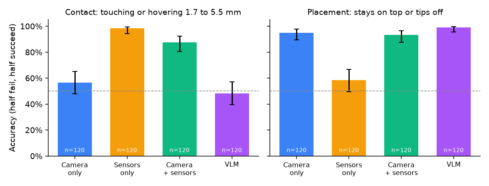
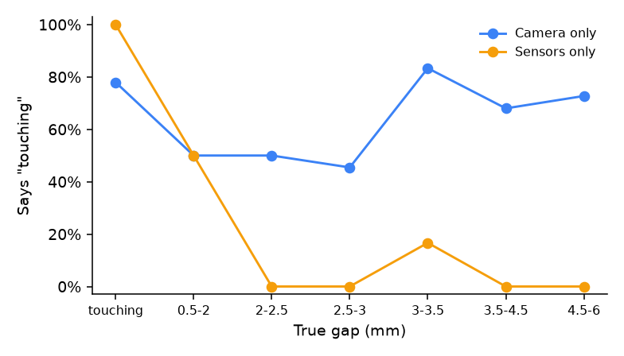
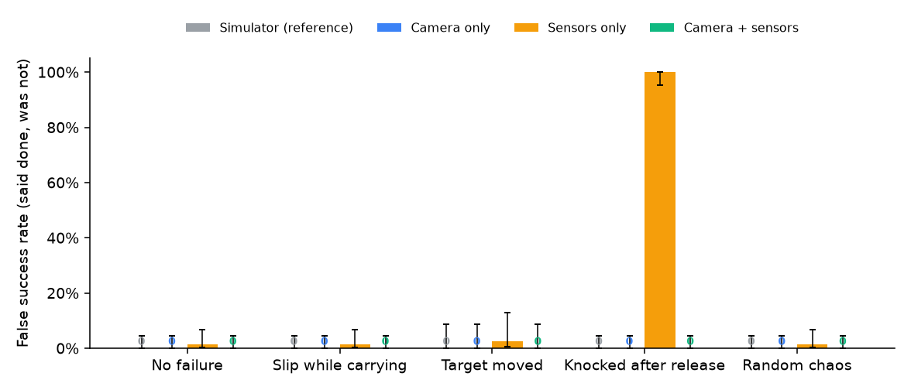
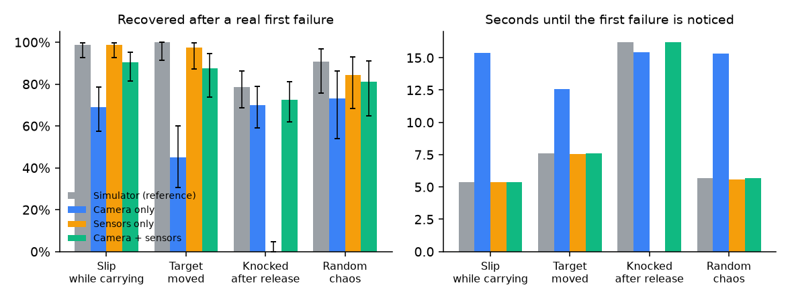
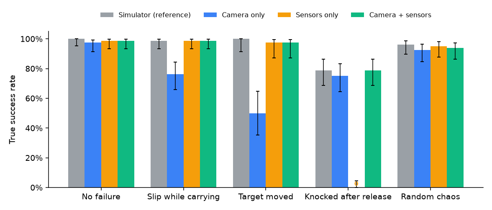

# Experiment results

Generated by `research/scripts/analyze_experiments.py` from the CSV logs in `experiments/data`. All numbers come from simulation.

## 1. Full episodes: who decides that the task is done

80 seeded tasks (stack, tower, sort, zone; generated by `generateTasks(20, 1000)`), scripted planner, up to 3 replans.
Each row is one decision rule. The simulator's own state is the ground truth used for scoring in every row;
only the reference row also uses it to decide. Camera only means the robot also runs without touch or force sensing.

- **True success**: the goal really holds at the end.
- **False success**: the agent said it was done but the goal does not hold.
- **Caught**: of the episodes whose first attempt really failed, how many the agent noticed.
- **Recovered**: of those, how many ended in a real, declared success after replanning.
- **Time to detect**: simulated seconds from the start of the first attempt until it ended as failed.

Brackets are 95% Wilson confidence intervals.

### No failure

| Decider | Episodes | True success | False success | Caught | Recovered | Avg attempts | Time to detect (s) |
|---|---|---|---|---|---|---|---|
| Simulator (reference) | 80 | 80/80 = 100% [95, 100] | 0/80 = 0% [0, 5] | 1/1 = 100% [21, 100] | 1/1 = 100% [21, 100] | 1.02 | 17.6 |
| Camera only | 80 | 78/80 = 98% [91, 99] | 0/80 = 0% [0, 5] | 1/1 = 100% [21, 100] | 0/1 = 0% [0, 79] | 1.23 | 16.3 |
| Sensors only | 80 | 79/80 = 99% [93, 100] | 1/80 = 1% [0, 7] | 0/1 = 0% [0, 79] | 0/1 = 0% [0, 79] | 1.00 |  |
| Camera + sensors | 80 | 79/80 = 99% [93, 100] | 0/80 = 0% [0, 5] | 1/1 = 100% [21, 100] | 1/1 = 100% [21, 100] | 1.29 | 17.6 |

### Slip while carrying

| Decider | Episodes | True success | False success | Caught | Recovered | Avg attempts | Time to detect (s) |
|---|---|---|---|---|---|---|---|
| Simulator (reference) | 80 | 79/80 = 99% [93, 100] | 0/80 = 0% [0, 5] | 73/73 = 100% [95, 100] | 72/73 = 99% [93, 100] | 1.94 | 5.4 |
| Camera only | 80 | 61/80 = 76% [66, 84] | 0/80 = 0% [0, 5] | 71/71 = 100% [95, 100] | 49/71 = 69% [58, 79] | 2.46 | 15.4 |
| Sensors only | 80 | 79/80 = 99% [93, 100] | 1/80 = 1% [0, 7] | 73/73 = 100% [95, 100] | 72/73 = 99% [93, 100] | 2.00 | 5.4 |
| Camera + sensors | 80 | 79/80 = 99% [93, 100] | 0/80 = 0% [0, 5] | 73/73 = 100% [95, 100] | 66/73 = 90% [82, 95] | 2.20 | 5.4 |

### Target moved

| Decider | Episodes | True success | False success | Caught | Recovered | Avg attempts | Time to detect (s) |
|---|---|---|---|---|---|---|---|
| Simulator (reference) | 40 | 40/40 = 100% [91, 100] | 0/40 = 0% [0, 9] | 40/40 = 100% [91, 100] | 40/40 = 100% [91, 100] | 2.00 | 7.6 |
| Camera only | 40 | 20/40 = 50% [35, 65] | 0/40 = 0% [0, 9] | 40/40 = 100% [91, 100] | 18/40 = 45% [31, 60] | 3.10 | 12.6 |
| Sensors only | 40 | 39/40 = 98% [87, 100] | 1/40 = 2% [0, 13] | 39/40 = 98% [87, 100] | 39/40 = 98% [87, 100] | 1.98 | 7.6 |
| Camera + sensors | 40 | 39/40 = 98% [87, 100] | 0/40 = 0% [0, 9] | 40/40 = 100% [91, 100] | 35/40 = 88% [74, 95] | 2.25 | 7.6 |

### Knocked after release

| Decider | Episodes | True success | False success | Caught | Recovered | Avg attempts | Time to detect (s) |
|---|---|---|---|---|---|---|---|
| Simulator (reference) | 80 | 63/80 = 79% [69, 86] | 0/80 = 0% [0, 5] | 80/80 = 100% [95, 100] | 63/80 = 79% [69, 86] | 2.49 | 16.2 |
| Camera only | 80 | 60/80 = 75% [65, 83] | 0/80 = 0% [0, 5] | 80/80 = 100% [95, 100] | 56/80 = 70% [59, 79] | 2.60 | 15.4 |
| Sensors only | 80 | 0/80 = 0% [0, 5] | 80/80 = 100% [95, 100] | 0/80 = 0% [0, 5] | 0/80 = 0% [0, 5] | 1.00 |  |
| Camera + sensors | 80 | 63/80 = 79% [69, 86] | 0/80 = 0% [0, 5] | 80/80 = 100% [95, 100] | 58/80 = 72% [62, 81] | 2.60 | 16.2 |

### Random chaos

| Decider | Episodes | True success | False success | Caught | Recovered | Avg attempts | Time to detect (s) |
|---|---|---|---|---|---|---|---|
| Simulator (reference) | 80 | 77/80 = 96% [90, 99] | 0/80 = 0% [0, 5] | 32/32 = 100% [89, 100] | 29/32 = 91% [76, 97] | 1.64 | 5.7 |
| Camera only | 80 | 74/80 = 92% [85, 97] | 0/80 = 0% [0, 5] | 26/26 = 100% [87, 100] | 19/26 = 73% [54, 86] | 1.66 | 15.3 |
| Sensors only | 80 | 76/80 = 95% [88, 98] | 1/80 = 1% [0, 7] | 31/32 = 97% [84, 99] | 27/32 = 84% [68, 93] | 1.88 | 5.6 |
| Camera + sensors | 80 | 75/80 = 94% [86, 97] | 0/80 = 0% [0, 5] | 32/32 = 100% [89, 100] | 26/32 = 81% [65, 91] | 2.10 | 5.7 |

## 2. Checkpoints built to be hard for the camera

Minimal pairs from the agent's own robot and cubes. Half of each set succeeds and half fails, by construction (even seeds succeed).

- **Contact**: the robot lowers a held cube onto another and stops either in contact or hovering just above it (measured gaps 1.7 to 5.5 mm). The image is taken at that moment, gripper in view. Ground truth is the simulated gap (contact means under 0.5 mm).
- **Placement**: the robot releases the cube on top of another, either centered (0 to 10 mm off) or 28 to 36 mm off along a face, so it tips off. The image is taken after the arm moves away. Ground truth is the simulator's `on` check.

Sensors: the agent's rule (wrist force rises more than 2 N while lowering). Camera: OpenCV detector (`research/vcf/detect.py`), image only. Combined: success only if both say success.

| Checkpoint | Verifier | Pairs | Accuracy | Catches failures | Passes successes | False success |
|---|---|---|---|---|---|---|
| contact | Camera only | 120 | 68/120 = 57% [48, 65] | 22/61 = 36% [25, 49] | 46/59 = 78% [66, 87] | 39/61 = 64% [51, 75] |
| contact | Sensors only | 120 | 118/120 = 98% [94, 100] | 59/61 = 97% [89, 99] | 59/59 = 100% [94, 100] | 2/61 = 3% [1, 11] |
| contact | Camera + sensors | 120 | 105/120 = 88% [80, 92] | 59/61 = 97% [89, 99] | 46/59 = 78% [66, 87] | 2/61 = 3% [1, 11] |
| contact | VLM gemini-3.1-flash-lite | 120 | 58/120 = 48% [40, 57] | 13/61 = 21% [13, 33] | 45/59 = 76% [64, 85] | 48/61 = 79% [67, 87] |
| place | Camera only | 120 | 114/120 = 95% [90, 98] | 54/54 = 100% [93, 100] | 60/66 = 91% [82, 96] | 0/54 = 0% [0, 7] |
| place | Sensors only | 120 | 70/120 = 58% [49, 67] | 7/54 = 13% [6, 24] | 63/66 = 95% [87, 98] | 47/54 = 87% [76, 94] |
| place | Camera + sensors | 120 | 112/120 = 93% [87, 97] | 54/54 = 100% [93, 100] | 58/66 = 88% [78, 94] | 0/54 = 0% [0, 7] |
| place | VLM gemini-3.1-flash-lite | 120 | 119/120 = 99% [95, 100] | 53/54 = 98% [90, 100] | 66/66 = 100% [94, 100] | 1/54 = 2% [0, 10] |

## Figures

